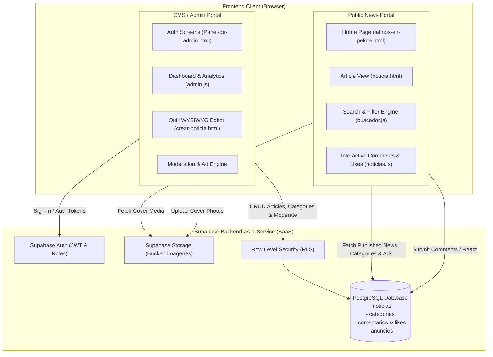

# Latinos en Pelota

<p align="center">
  
</p>

<p align="center">
  <em>"El deporte latino, a otro nivel" — Latin American sports journalism at the next level.</em>
</p>

---

## 📖 About The Project

**Latinos en Pelota** is a high-performance sports journalism web portal and content management platform dedicated to covering Latin American athletics, baseball, soccer, basketball, and more. 

The platform is designed to provide sports fans with real-time news updates, breaking headlines, rich media articles, and interactive community features, while equipping journalists and site administrators with a full-featured content management system (CMS) to manage the entire publication lifecycle without needing complex server maintenance.

### Key Capabilities

#### 🌐 Public News Portal
- **Featured Hero Story**: Prominently highlights primary breaking news and top stories on the front page.
- **Dynamic Sports Categorization**: Filter articles seamlessly across categories (e.g., Baseball, Football, Basketball, Track & Field).
- **Advanced Search & Date Filtering**: Quick client-side filtering by publication date (last 7 days, current month, past months) and real-time text query search.
- **Dedicated Article Reader**: Clean reading experience displaying publish date, estimated reading time, author, view counts, rich multimedia content, and social sharing links.
- **Interactive Community Engagement**: Registered users can leave comments, participate in discussions, and like community commentary.
- **Dynamic Ad Banner Engine**: Built-in horizontal and lateral ad slot management to support monetization.
- **Privacy & Cookie Consent**: Fully integrated privacy policy and customizable cookie consent management banner.

#### ⚙️ Administrative Control Panel (CMS)
- **Role-Based Authentication**: Secure authentication via Supabase Auth (Sign-in, registration, email confirmation, password recovery).
- **Real-Time Analytics Dashboard**: Overview cards showing published articles, total page views, active categories, and pending comments.
- **News Article Authoring & Editing**:
  - WYSIWYG rich text editor powered by **Quill.js** for formatted stories, blockquotes, media links, and lists.
  - Image cover upload with cloud storage and fallback handling.
  - Draft vs. Published status toggling and Hero story assignment.
- **Category Management**: Create, customize color accents, update slugs, and delete sports categories.
- **Comment Moderation System**: Real-time moderation pipeline to approve, filter, or delete comments submitted by readers.
- **Ad Management**: Manage sponsor banners, external redirect links, and targeted placements.
- **User Administration**: Administrative monitoring of registered users, roles, and profiles.

---

## 🛠️ Tools & Technologies Used

### Frontend
- **HTML5**: Semantic, accessible markup optimized for search engine indexing and responsive viewport sizing.
- **CSS3**: Custom design system using CSS variables, fluid responsive layouts via CSS Grid and Flexbox, and custom sports styling themes.
- **Vanilla JavaScript (ES6+)**: Lightweight, modern client-side scripting without heavy framework overhead, ensuring fast load times and high performance.
- **[Quill.js v2](https://quilljs.com/)**: Modern WYSIWYG rich text editor for news article creation and formatted publishing.
- **Google Fonts (Inter)**: Typography focused on readability across desktop and mobile devices.

### Backend-as-a-Service (BaaS) & Cloud
- **[Supabase](https://supabase.com/)**: Open-source Firebase alternative powering the entire backend infrastructure:
  - **PostgreSQL Database**: Relational database storing news, categories, comments, comment likes, ads, and system profiles.
  - **Supabase Auth**: Secure JWT-based user authentication, role management, password recovery, and email verification.
  - **Supabase Storage**: Object cloud storage (in the `imagenes` bucket) for news cover photos and advertising assets.
  - **Row-Level Security (RLS)**: Enforces database-level access control policies so public users can only read published content while admin users have write/edit access.
  - **Supabase JS Client v2**: CDN-delivered browser SDK communicating securely over RESTful HTTPS APIs.

---

## 🏛️ System Architecture

Latinos en Pelota follows a **Serverless Jamstack / Decoupled Client-BaaS Architecture**. Static web assets are served directly to the browser, while all dynamic data operations, authentication flows, and media storage are delegated directly to cloud services via Supabase.

### Architectural Diagram



### Architecture Highlights
1. **Decoupled Client & Server**: Front-end HTML/CSS/JS files are completely decoupled from backend servers. They can be deployed to any static CDN host (GitHub Pages, Vercel, Netlify, Cloudflare Pages, S3).
2. **Direct-to-Database Security**: Utilizing Supabase's Row-Level Security (RLS), clients securely execute queries directly against Postgres without exposing database credentials; read operations on published articles are publicly available, while mutation operations require authenticated admin credentials.
3. **Optimized Asset Delivery**: Static UI assets and logos load locally or via fast CDNs, while media-heavy article images are hosted and delivered via object storage.

---

## 📂 Project Directory Structure

```plaintext
latinos-en-pelota-1/
├── assets/
│   ├── .gitkeep
│   └── Logo latinos .png              # Official project logo and favicon
├── css/
│   ├── admin.css                      # Styling for the CMS administration panel
│   ├── extras.css                     # Common modal, utility, and layout extras
│   ├── pagPrincipal.css               # Styling for home page layout and hero section
│   ├── redaccion.css                  # Styling for news drafting & editor workspace
│   └── style.css                      # Global design system, typography, and theme
├── js/
│   ├── admin.js                       # Admin dashboard logic, CRUD operations, moderation
│   ├── buscador.js                    # Live search, category tabs, and date filters
│   ├── consentimiento.js              # Cookie banner and user consent handler
│   ├── crear-noticia.js               # Article editor logic, image upload, Quill integration
│   ├── noticias.js                    # Article page renderer, comments, likes, ad banners
│   ├── privacidad.js                  # Privacy policy tab and navigation logic
│   ├── recuperar-contrasena.js        # Password reset and recovery flow
│   └── supabase-config.js             # Supabase client initialization & header date script
├── correo-confirmacion.html           # Email confirmation landing screen
├── crear-noticia.html                 # News editor and article authoring interface
├── index.html                         # Entry point redirecting to main news feed
├── latinos-en-pelota.html             # Main public portal and news feed
├── noticia.html                       # Individual news story viewing page
├── Panel-de-admin.html                # CMS admin dashboard & authentication view
├── politica-de-privacidad.html        # Privacy policy & cookie terms page
├── recuperar-contrasena.html          # Password recovery request interface
└── README.md                          # Project documentation
```

---

## 🚀 Getting Started

### Prerequisites
To run or preview this project locally, all you need is a modern web browser and a local HTTP server.

### Local Setup
1. **Clone the repository**:
   ```bash
   git clone https://github.com/your-username/latinos-en-pelota-1.git
   cd latinos-en-pelota-1
   ```

2. **Launch a local static server**:
   Because modern browsers enforce CORS restrictions on ES modules and script requests from `file://`, serve the project using a local server:
   - **Using VS Code**: Open the folder and click **"Go Live"** using the *Live Server* extension.
   - **Using Python 3**:
     ```bash
     python -m http.server 8000
     ```
   - **Using Node.js (`npx`)**:
     ```bash
     npx serve .
     ```

3. **Access the application**:
   - **Public Portal**: Open [http://localhost:8000/index.html](http://localhost:8000/index.html) (or `latinos-en-pelota.html`)
   - **Admin CMS**: Open [http://localhost:8000/Panel-de-admin.html](http://localhost:8000/Panel-de-admin.html)

---

## ⚙️ Configuration & Backend Setup

The application communicates with a Supabase project defined in [js/supabase-config.js](file:///c:/Users/rober/OneDrive/Escritorio/Codigos%20Gitgub/latinos-en-pelota-1/js/supabase-config.js):

```javascript
const SUPABASE_URL = 'https://<your-project>.supabase.co';
const SUPABASE_ANON_KEY = '<your-anon-key>';
```

### Database Schema Requirements
For a custom deployment, ensure your Supabase instance contains the following resources:
- **Tables**:
  - `noticias`: Stores articles (`id`, `titulo`, `subtitulo`, `contenido`, `categoria_id`, `imagen_url`, `es_destacada`, `estado`, `vistas`, `fecha_publicacion`, `created_at`).
  - `categorias`: Sports categories (`id`, `nombre`, `slug`, `color`).
  - `comentarios`: Reader comments (`id`, `noticia_id`, `autor`, `texto`, `estado`, `created_at`).
  - `comentario_likes`: User reactions (`id`, `comentario_id`, `user_id`, `created_at`).
  - `anuncios`: Advertising banners (`id`, `titulo`, `enlace_url`, `imagen_url`, `posicion`, `activo`).
- **Views**:
  - `noticias_publicadas`: Filtered view of published articles with category relationships.
  - `categorias_con_conteo_noticias`: Aggregate view for category article counts.
- **Storage**:
  - Bucket name: `imagenes` (Public bucket configured for image uploads).

---

## 📄 License & Attribution

This project is developed for sports journalism and editorial operations under the **Latinos en Pelota** brand. All rights reserved © 2026.
